# 02 — Code structure၊ functions နှင့် ရောင်စုံ Mermaid diagrams

ဤစာတမ်းသည် **လက်ရှိ project source code အတိုင်း** module structure၊ class/state၊ function တစ်ခုချင်းစီ၊ call flow နှင့် data flow ကို ရှင်းပြထားတာ ဖြစ်ပါတယ်။ အနာဂတ်ဒီဇိုင်းကို လက်ရှိ implementation နှင့် မရောထားပါ။

Install/run နည်းအတွက် [01_README.md](./01_README.md) ကို ကြည့်ပါ။ ဤနေရာတွင် code အတွင်းပိုင်းကို အဓိက ရှင်းပြပါတယ်။

> **လက်ရှိ system:** FlyWire connectivity + NumPy LIF SNN + FlyGym walking controller/body + MuJoCo physics။ Odyssey-3 integration၊ video export၊ interactive viewer နှင့် biological mapping အတည်ပြုချက် မပါသေးပါ။

## မာတိကာ

1. [Architecture နှင့် အရောင်သတ်မှတ်ချက်](#1-architecture)
2. [ဖိုင်နှင့် module dependency structure](#2-code-structure)
3. [Objects၊ state နှင့် data contracts](#3-objects-and-data-contracts)
4. [Connectome module](#4-connectome-module)
5. [LIF module](#5-lif-module)
6. [World module](#6-world-module)
7. [Closed-loop module နှင့် CLI](#7-closed-loop-module)
8. [Runtime sequence နှင့် timing](#8-runtime-sequence-and-timing)
9. [Output နှင့် persistence](#9-output-and-persistence)
10. [Tests နှင့် coverage boundaries](#10-tests-and-coverage-boundaries)
11. [Errors၊ assumptions နှင့် extension points](#11-errors-and-extension-points)

## 1. Architecture

Diagram labels များတွင် source code နှင့် တိုက်ဆိုင်ရှာရလွယ်ရန် English identifiers ကို သုံးထားပြီး ရှင်းလင်းချက်ကို မြန်မာလို ရေးထားပါတယ်။

| အရောင် | Diagram အတွင်း အဓိပ္ပာယ် |
| --- | --- |
| အပြာ | CLI၊ orchestration၊ branching နှင့် control flow |
| ခရမ်း | Source data၊ connectivity၊ pool indices နှင့် cache |
| အစိမ်း | SNN configuration၊ state နှင့် neural computation |
| လိမ္မော် | FlyGym world၊ body၊ sensors နှင့် physics |
| စိမ်းပြာ | Records၊ metrics၊ output နှင့် tests |
| အနီ | Error၊ unavailable feature နှင့် သတိပြုရန် behavior |
| မီးခိုး | External libraries သို့မဟုတ် package scaffolding |

**Diagram ကြည့်ရန်:** VS Code တွင် Markdown Preview (`Ctrl+Shift+V`) ဖွင့်ပါ။ Preview က Mermaid rendering ကို support လုပ်ရန် လိုပါတယ်။ Diagram အစား code block ပဲ မြင်ရလျှင် Mermaid-supporting Markdown renderer/extension ကို အသုံးပြုပါ။ အရောင်များကို diagram တစ်ခုစီအတွင်း သတ်မှတ်ထားပြီး external image links မသုံးထားပါ။

```mermaid
flowchart LR
    raw["FlyWire v783<br/>root IDs + connectivity"]:::data
    conn["Connectome<br/>CSR weights + neuron pools"]:::data
    net["LIFNetwork<br/>membrane state + spikes"]:::brain
    decode["Motor decoder<br/>left/right drive"]:::control
    ctrl["HybridTurningController<br/>joint + adhesion control"]:::world
    body["MuJoCo<br/>NeuroMechFly body + arena"]:::world
    eyes["FlyGym vision<br/>mean brightness per eye"]:::world
    rec["Trajectory + activity records<br/>optional NPZ output"]:::record
    ody["OdysseyWorld<br/>NotImplementedError"]:::error

    raw --> conn
    conn -->|"weights initialize network"| net
    conn -->|"input/output pool indices"| decode
    eyes -->|"external input at input pools"| net
    net -->|"spikes"| decode
    decode -->|"drive: shape 2"| ctrl
    ctrl --> body
    body --> eyes
    body -->|"positions"| rec
    decode -->|"rates + drives"| rec
    net -->|"spike count"| rec

    classDef data fill:#ede9fe,stroke:#7c3aed,color:#2e1065;
    classDef brain fill:#dcfce7,stroke:#16a34a,color:#14532d;
    classDef control fill:#dbeafe,stroke:#2563eb,color:#172554;
    classDef world fill:#ffedd5,stroke:#ea580c,color:#7c2d12;
    classDef record fill:#ccfbf1,stroke:#0f766e,color:#134e4a;
    classDef error fill:#fee2e2,stroke:#dc2626,color:#7f1d1d;
```

**အရေးကြီးသော ခွဲခြားချက်:** SNN က ခြေထောက် joint တစ်ခုချင်းကို တိုက်ရိုက် မထိန်းပါ။ SNN output ကို `[left, right]` descending drive အဖြစ် ပြောင်းပြီး FlyGym controller က joint/adhesion actions ကို ဆက်တွက်ပါတယ်။ အထက် diagram ရှိ decoder သည် သီးခြား class မဟုတ်ဘဲ [run_closed_loop()](./closed_loop.py) အတွင်းက logic ဖြစ်ပါတယ်။

## 2. Code structure

```text
fruit_fly_brain/                  <- project root
├── requirements.txt
├── Copilot.md
├── fruitfly_brain/               <- Python package
│   ├── __init__.py
│   ├── 01_README.md
│   ├── 02_CODE.md
│   ├── connectome.py
│   ├── lif.py
│   ├── world.py
│   └── closed_loop.py
├── tests/
│   ├── test_connectome.py
│   ├── test_lif.py
│   └── test_world.py
└── data/
    ├── proofread_connections_783.feather
    ├── proofread_root_ids_783.npy
    ├── cache/connectome.npz
    └── runs/final_1s.npz
```

### 2.1 Module dependencies

ဤ diagram မှာ arrow သည် import/dependency direction ဖြစ်ပါတယ်။ Runtime sensory feedback direction ကို ပြထားသော အပေါ်က architecture diagram နှင့် မတူပါ။

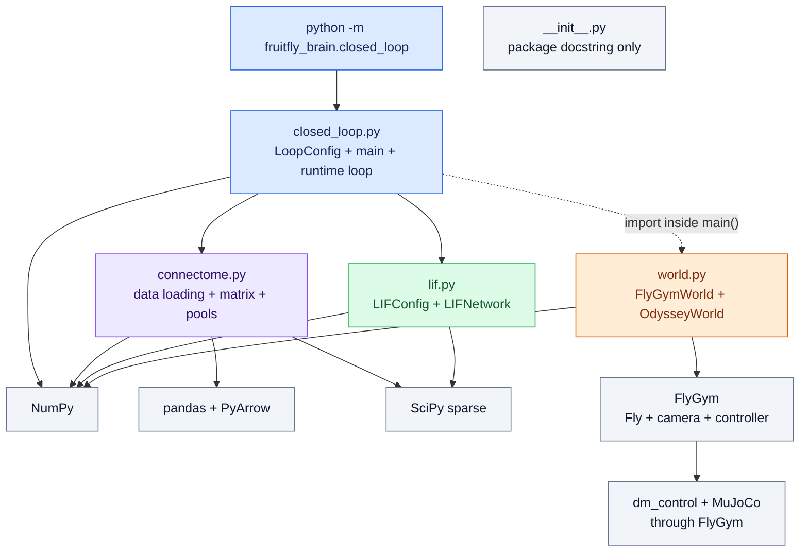

- [__init__.py](./__init__.py) တွင် package docstring သာရှိပြီး initialization logic သို့မဟုတ် re-exported API မရှိပါ။
- [connectome.py](./connectome.py) နှင့် [lif.py](./lif.py) သည် FlyGym ကို import မလုပ်ပါ။
- [closed_loop.py](./closed_loop.py) မှ [FlyGymWorld](./world.py) ကို module top level မဟုတ်ဘဲ [main()](./closed_loop.py) အတွင်း import လုပ်ထားပါတယ်။
- [run_closed_loop()](./closed_loop.py) သည် world object ကို argument အဖြစ် လက်ခံပြီး သီးခြား world instance ကို ကိုယ်တိုင် မဆောက်ပါ။
- Source တွင် custom base class၊ formal `Protocol`၊ dependency-injection framework သို့မဟုတ် backend registry မရှိပါ။ World interface သည် လက်ရှိ duck typing ဖြစ်ပါတယ်။

## 3. Objects and data contracts

### 3.1 Class နှင့် state ownership

အောက်ပါ boxes များသည် တကယ်ရှိသော classes ဖြစ်ပါတယ်။ Arrow များသည် inheritance မဟုတ်ဘဲ object/data အသုံးပြုပုံကို ပြပါတယ်။

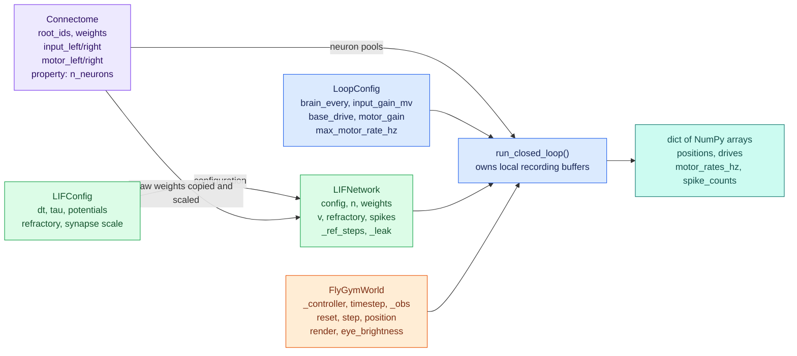

[Connectome](./connectome.py)၊ [LIFConfig](./lif.py) နှင့် [LoopConfig](./closed_loop.py) သည် `@dataclass(frozen=True)` ဖြစ်ပါတယ်။ Dataclass က constructor ကို generate လုပ်ပေးတာဖြစ်ပြီး source ထဲတွင် explicit `__init__()` မရေးထားပါ။ `frozen=True` သည် fields ကို ပြန် assign မလုပ်နိုင်ရန်သာ ဖြစ်ပြီး [Connectome](./connectome.py) အတွင်း NumPy arrays/CSR matrix ကို deep immutable ဖြစ်စေတာ မဟုတ်ပါ။

### 3.2 Array contracts

`N` = neurons အရေအတွက်၊ `P` = physics steps၊ `B` = SNN updates ဟု သတ်မှတ်ပါ။

| Data | Shape / representation | အဓိပ္ပာယ် |
| --- | --- | --- |
| `root_ids` | `(N,)`, NumPy array | FlyWire neuron IDs၊ source list ၏ order ကို ထိန်းထားပါတယ်။ |
| `weights` | `(N, N)`, SciPy CSR၊ data `float32` | `weights[post, pre]` ဖြစ်ပါတယ်။ Dense matrix အဖြစ် မဆောက်ပါ။ |
| `input_left`, `input_right` | 1D integer index arrays | Raw root IDs မဟုတ်ဘဲ `root_ids` အတွင်း positions ဖြစ်ပါတယ်။ |
| `motor_left`, `motor_right` | 1D integer index arrays | Motor proxy pools ဖြစ်ပါတယ်။ |
| `external` | `(N,)`, `float32` | SNN step တစ်ကြိမ်အတွက် ထပ်ပေါင်းသော mV input ဖြစ်ပါတယ်။ |
| `net.v` | `(N,)`, initially `float32` | Membrane potentials ဖြစ်ပါတယ်။ |
| `net.refractory` | `(N,)`, `int32` | ကျန်ရှိသော refractory steps ဖြစ်ပါတယ်။ |
| `net.spikes` | `(N,)`, boolean | ယခင်/လက်ရှိ SNN step ၏ firing mask ဖြစ်ပါတယ်။ |
| `obs["vision"]` | ပုံမှန် `(2, 721, 2)` | FlyGym compound-eye output ဖြစ်ပါတယ်။ |
| `eye` | `(2,)`, floating-point | မျက်စိဘယ်/ညာ mean brightness ဖြစ်ပါတယ်။ |
| `rates`, `drive` | `(2,)`, floating-point | ဘယ်/ညာ motor rate နှင့် descending drive ဖြစ်ပါတယ်။ |
| `positions` | `(P, 3)`, default NumPy float | Physics step တိုင်းပြီးနောက် body position ဖြစ်ပါတယ်။ |
| `drives`, `motor_rates_hz` | `(B, 2)` for nonempty run | SNN update တိုင်း၏ decoder outputs ဖြစ်ပါတယ်။ |
| `spike_counts` | `(B,)`, integer | SNN step တိုင်း၏ total spike events ဖြစ်ပါတယ်။ |

ဤသည် လက်ရှိ code သုံးသည့် contracts ဖြစ်ပြီး shapes/dtypes အားလုံးကို runtime မှာ explicit validate လုပ်ထားခြင်း မဟုတ်ပါ။ ဥပမာ [LIFNetwork.step()](./lif.py) ကို floating dtype မတူသော array ပေးလျှင် NumPy promotion ဖြစ်နိုင်ပါတယ်။

## 4. Connectome module

ရင်းမြစ်: [connectome.py](./connectome.py)။

### 4.1 Constants နှင့် data model

| Symbol | Value / တာဝန် |
| --- | --- |
| `EDGE_COLUMNS` | `pre_pt_root_id`, `post_pt_root_id`, `neuropil`, `syn_count`, `ach_avg`, `gaba_avg`, `glut_avg` columns ကိုသာ Feather မှ ဖတ်ရန်။ |
| `VISUAL_NEUROPILS` | Left = `ME_L`, `LO_L`; right = `ME_R`, `LO_R`။ |
| `OUTPUT_NEUROPIL` | `GNG`၊ motor-output proxy ရွေးရာတွင် သုံးပါတယ်။ |
| [Connectome](./connectome.py) | Root IDs၊ signed CSR weights၊ input/motor pools ကို တစ်စုတည်း ထိန်းထားပါတယ်။ |
| [Connectome.n_neurons](./connectome.py) | `int(root_ids.shape[0])` ကို return လုပ်သော read-only property ဖြစ်ပါတယ်။ |

### 4.2 Function inventory

အောက်တွင် path arguments များသည် `str | Path` ဖြစ်ပါတယ်။ `_` ဖြင့်စသော functions များသည် internal helpers ဖြစ်ပါတယ်။

| Function | Input → output | လက်ရှိ တာဝန် |
| --- | --- | --- |
| [signed_synapse_weight(edges)](./connectome.py) | DataFrame → `float32` array | Row တစ်ခုစီအတွက် `syn_count * (ach_avg - gaba_avg - glut_avg)` တွက်ပါတယ်။ |
| [_side_labels(neuropil)](./connectome.py) | Array → `"L"`, `"R"`, `""` labels | Neuropil name ၏ `_L` / `_R` suffix ကို စစ်ပါတယ်။ ဘက်မရှိလျှင် empty label ဖြစ်ပါတယ်။ |
| [_lookup(root_ids, ids)](./connectome.py) | Arrays → `(positions, found_mask)` | Sorted search မှ ID → original-index mapping ကို ထုတ်ပါတယ်။ |
| [build_connectome(edges, root_ids, *, min_pool_synapses=10, min_pool_fraction=0.5)](./connectome.py) | DataFrame + IDs → [Connectome](./connectome.py) | Unknown IDs ဖယ်ခြင်း၊ weights aggregation နှင့် pools ရွေးခြင်း လုပ်ပါတယ်။ |
| [save_connectome(conn, path)](./connectome.py) | [Connectome](./connectome.py) + path → `None` | Parent folders ဆောက်ပြီး CSR components/pools ကို NPZ သိမ်းပါတယ်။ |
| [load_saved_connectome(path)](./connectome.py) | NPZ path → [Connectome](./connectome.py) | CSR matrix ကို components မှ ပြန်တည်ဆောက်ပါတယ်။ |
| [load_connectome(edges_path, root_ids_path, cache_path=None)](./connectome.py) | Source/cache paths → [Connectome](./connectome.py) | Cache ရှိလျှင် cache load၊ မရှိလျှင် build နှင့် optional save လုပ်ပါတယ်။ |

### 4.3 Cache decision flow

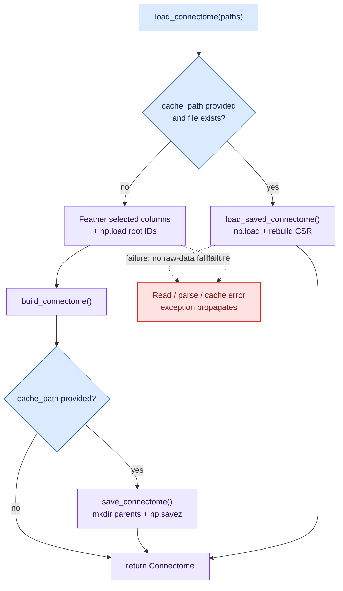

- Cache ရှိလျှင် raw paths ကို မဖတ်ပါ။ Raw source သို့မဟုတ် pool logic ပြောင်းသော်လည်း cache ကို auto-invalidate မလုပ်ပါ။
- `cache_path=None` ပေးလျှင် cache ကို မဖတ်/မသိမ်းဘဲ raw source မှ build လုပ်ပါတယ်။
- Cache corrupt ဖြစ်လျှင် raw-data fallback မရှိပါ။
- Loader သည် internet မှ auto-download မလုပ်ပါ။

### 4.4 Root ID → matrix index mapping

[_lookup()](./connectome.py) သည် original order ကို မပျက်စေဘဲ binary search သုံးပါတယ်။

```text
root_ids = [30, 10, 20]
ids      = [10, 30, 999]

valid mappings: 10 -> index 1, 30 -> index 0
found_mask:    [True, True, False]
```

Unknown ID အတွက် returned position သည် search/clamping ကြောင့် index တစ်ခု ရှိနေနိုင်သော်လည်း **`found_mask=False` ဖြစ်သော position ကို မသုံးရပါ။** [build_connectome()](./connectome.py) က `pre_ok & post_ok` ဖြင့် unknown edges ကို ဖယ်ထားပါတယ်။

လက်ရှိ helper သည် nonempty root-ID array ကို ယူဆထားပါတယ်။ Empty IDs၊ duplicate root IDs စသည့် invalid-input cases များကို explicit validate မလုပ်ထားပါ။

### 4.5 Matrix နှင့် neuron pool building

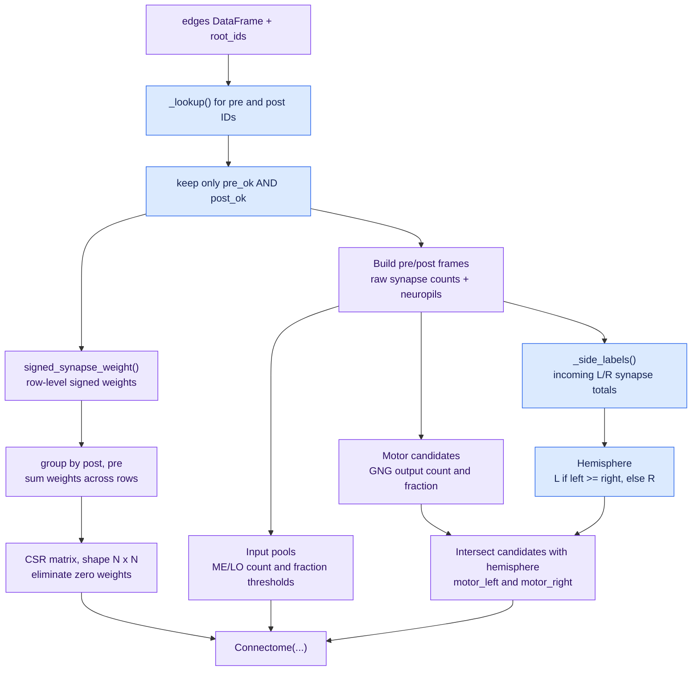

**Weight branch**

1. Pair တူသော rows များကို `(post, pre)` အလိုက် sum လုပ်ပါတယ်။
2. Matrix orientation သည် **row = post, column = pre** ဖြစ်ပါတယ်။
3. Excitatory/inhibitory signed weights ပေါင်းပြီး သုညရသည့် pairs ကို CSR မှ ဖယ်ပါတယ်။

**Pool-selection branch**

Pool thresholds သည် signed weight မဟုတ်ဘဲ **raw synapse counts** ကို သုံးပါတယ်။ Unknown-ID edges ဖယ်ပြီးသား retained edges အပေါ်မှသာ fractions တွက်ပါတယ်။

```text
input side qualifies if:
    optic incoming synapses >= 10
    AND optic incoming synapses / total incoming synapses >= 0.5

motor candidate qualifies if:
    GNG outgoing synapses >= 10
    AND GNG outgoing synapses / total outgoing synapses >= 0.5
```

- Motor hemisphere သည် incoming lateral-neuropil synapse counts ပိုများသည့်ဘက် ဖြစ်ပါတယ်။
- L/R input counts တူလျှင် code က left ကို ရွေးပါတယ်။
- Lateral input မရှိ၍ hemisphere label မရသော motor candidates များသည် left/right pool နှစ်ခုလုံးတွင် မပါပါ။
- Input pools နှစ်ခု disjoint ဖြစ်ရန် explicit rule မရှိပါ။ Motor proxy pools သည် hemisphere တစ်ခုစီဖြင့် ခွဲထားပါတယ်။
- ဤ mapping သည် heuristic ဖြစ်ပြီး verified photoreceptor/descending/motor neuron identities မဟုတ်ပါ။

## 5. LIF module

ရင်းမြစ်: [lif.py](./lif.py)။

### 5.1 Configuration

| [LIFConfig](./lif.py) field | Default | အဓိပ္ပာယ် |
| --- | --- | --- |
| `dt_ms` | `1.0` | Neural simulation timestep၊ ms |
| `tau_m_ms` | `20.0` | Membrane leak time constant၊ ms |
| `v_rest_mv` | `-65.0` | Rest potential၊ mV |
| `v_thresh_mv` | `-50.0` | Spike threshold၊ mV |
| `v_reset_mv` | `-65.0` | Spike/refractory reset potential၊ mV |
| `t_ref_ms` | `2.0` | Refractory duration၊ ms |
| `synapse_mv` | `1.0` | Scaled nonzero absolute synapse weights ၏ median၊ mV |

ဤ parameters များကို neurons အားလုံးအတွက် တူညီစွာ သုံးထားပါတယ်။ Cell-type-specific dynamics၊ plasticity သို့မဟုတ် synaptic conductance model မပါပါ။

### 5.2 Methods နှင့် state

| Method | Input → output | State change |
| --- | --- | --- |
| [LIFNetwork.__init__(weights, config=LIFConfig())](./lif.py) | CSR + config → new object | Weights ကို scale/copy လုပ်ပြီး `v`, `refractory`, `spikes` နှင့် derived constants ကို initialize လုပ်ပါတယ်။ |
| [LIFNetwork.reset()](./lif.py) | No argument → `None` | `v` ကို rest၊ refractory counters ကို 0၊ spikes ကို false ပြန်ထားပါတယ်။ Weights/config မပြောင်းပါ။ |
| [LIFNetwork.step(external_mv=None)](./lif.py) | Optional `(N,)` array → boolean `(N,)` | Neural timestep တစ်ခုရွှေ့ပြီး updated firing mask ကို return လုပ်ပါတယ်။ |

Initialization တွင်—

```text
scale = synapse_mv / median(abs(raw nonzero weights))
scaled_weights = raw_weights * scale
_ref_steps = round(t_ref_ms / dt_ms)
_leak = dt_ms / tau_m_ms
```

Stored weight data မရှိသည့် empty sparse matrix အတွက် scale ကို `1.0` ယူပါတယ်။ Raw [Connectome.weights](./connectome.py) ကို in-place မပြင်ဘဲ network အတွက် scaled CSR ကို သီးခြားတည်ဆောက်ပါတယ်။

### 5.3 Neural step flow

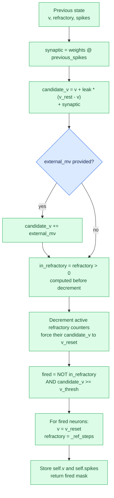

Discrete update equation၊ refractory/threshold handling မလုပ်မီ—

```text
alpha = dt_ms / tau_m_ms
synaptic[t] = W_scaled @ spikes[t-1]
candidate_v[t] =
    v[t-1] + alpha * (v_rest - v[t-1])
    + synaptic[t] + external_mv[t]
```

- `external_mv` သည် code အရ **step တိုင်း potential ထဲ တိုက်ရိုက် ထပ်ပေါင်းသော mV** ဖြစ်ပါတယ်။ Physical current in pA ဟု မယူဆရပါ။
- Presynaptic spike သည် နောက် neural step တွင် target ကို သက်ရောက်ပါတယ်။ Per-edge delay distributions မပါပါ။
- Refractory mask ကို counter decrement **မလုပ်မီ** တွက်ထားသောကြောင့် counter 1 မှ 0 ဖြစ်သွားသည့် step တွင်လည်း fire မလုပ်နိုင်သေးပါ။
- Default `t_ref_ms=2`, `dt_ms=1` နှင့် supra-threshold input အလွန်များလျှင် firing pattern သည် `spike, quiet, quiet, spike, ...` ဖြစ်ပြီး 1,000 Hz မရပါ။ Max sustained rate သည် ~333 Hz ဖြစ်ပါတယ်။
- Refractory state အတွင်း calculated input ကို membrane ထဲ ဆက်မသိမ်းဘဲ reset potential ဖြင့် override လုပ်ပါတယ်။

## 6. World module

ရင်းမြစ်: [world.py](./world.py)။

### 6.1 Construction နှင့် internal components

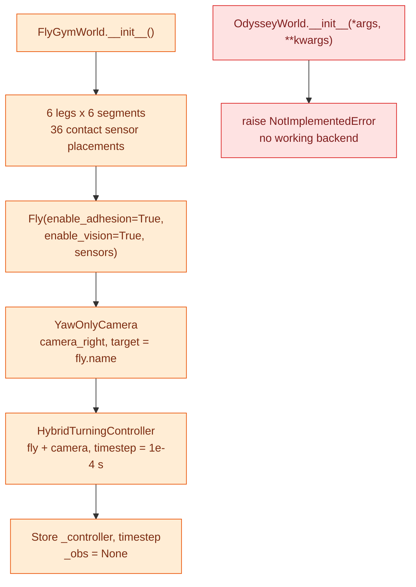

- `LEGS = ("LF", "LM", "LH", "RF", "RM", "RH")` ဖြစ်ပါတယ်။
- `LEG_SEGMENTS` တွင် `Tibia`, `Tarsus1` မှ `Tarsus5` အထိ ပါပါတယ်။
- Contact sensor names များကို leg/segment combinations ဖြင့် ဆောက်ပါတယ်။
- Custom arena မပေးထားသောကြောင့် controller/simulation ၏ default flat arena ကို သုံးပါတယ်။
- Body XML ကို override မလုပ်ထားသောကြောင့် FlyGym 1.2.1 ၏ default `seqik` model ကို သုံးပါတယ်။
- Camera သည် body ကို ပြင်ပမှကြည့်သော observation/rendering camera ဖြစ်ပြီး fly compound eyes နှင့် သီးခြားဖြစ်ပါတယ်။

### 6.2 Method inventory

| Method / property | Input → output | လက်ရှိ behavior |
| --- | --- | --- |
| [FlyGymWorld.__init__()](./world.py) | No arguments → new object | Fly၊ camera၊ controller နှင့် timestep ဆောက်ပါတယ်။ World reset ကို မခေါ်သေးပါ။ |
| [FlyGymWorld.reset()](./world.py) | No argument → eye `(2,)` | Controller reset မှ `(obs, info)` ယူပြီး `_obs` update လုပ်ပါတယ်။ `info` ကို caller သို့ မပို့ပါ။ |
| [FlyGymWorld.step(drive)](./world.py) | Array-like `[left, right]` → eye `(2,)` | Drive ကို float array ပြောင်းပြီး controller ကို physics step တစ်ခု advance လုပ်စေပါတယ်။ |
| [FlyGymWorld.position](./world.py) | Property → `(3,)` | Latest `_obs["fly"][0]` မှ position ကို ယူပါတယ်။ Reset/step မလုပ်မီ `_obs=None` ဖြစ်ပါတယ်။ |
| [FlyGymWorld.render()](./world.py) | No argument → `None` | Controller ၏ render ကို ခေါ်ပါတယ်။ Wrapper က frame ကို return မလုပ်ပါ။ |
| [FlyGymWorld.eye_brightness(obs)](./world.py) | Observation dict → `(2,)` | Static method ဖြစ်ပြီး vision ကို normalize/average လုပ်ပါတယ်။ |
| [OdysseyWorld.__init__(*args, **kwargs)](./world.py) | Any arguments → exception | ချက်ချင်း `NotImplementedError` ပေးပါတယ်။ Usable world instance မရပါ။ |

[FlyGymWorld.step()](./world.py) တွင် controller ပြန်ပေးသော observation အပြင် reward၊ termination/truncation flags နှင့် info စသော ကျန် return values များကို caller သို့ မပို့ပါ။ ဤ wrapper သည် full Gymnasium environment API မဟုတ်ပါ။

### 6.3 Eye brightness encoding

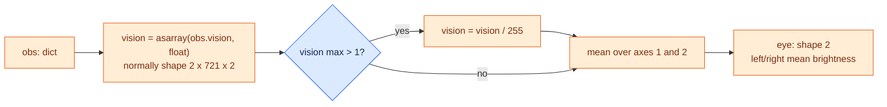

Encoder သည် 0–255 သို့မဟုတ် 0–1 vision values ဟူသော assumption အောက်တွင် သုံးထားပါတယ်။ Input range ကို explicit clip/validate မလုပ်ပါ။ Ommatidia တည်နေရာ၊ channel-specific processing၊ image contrast နှင့် optic flow တို့ကို averaging ကြောင့် မထိန်းထားပါ။

[FlyGymWorld.render()](./world.py) သည် ရှိသော်လည်း [run_closed_loop()](./closed_loop.py) မှ မခေါ်ပါ။ ထို့ကြောင့် default CLI run သည် video/viewer မထုတ်ပါ။

## 7. Closed-loop module

ရင်းမြစ်: [closed_loop.py](./closed_loop.py)။

### 7.1 Constants နှင့် configuration

- `PROJECT_ROOT = Path(__file__).resolve().parents[1]` ဖြစ်ပါတယ်။
- `DATA_DIR = PROJECT_ROOT / "data"` ဖြစ်ပါတယ်။
- Default source/cache paths ကို current working directory မှမဟုတ်ဘဲ `PROJECT_ROOT` မှ တွက်ပါတယ်။

| [LoopConfig](./closed_loop.py) field | Default | အသုံးပြုပုံ |
| --- | --- | --- |
| `brain_every` | `10` | Physics steps per neural update |
| `input_gain_mv` | `3.0` | Eye brightness မှ input mV သို့ scaling |
| `base_drive` | `0.8` | Brain activity မရှိလည်း ထည့်ထားသော drive |
| `motor_gain` | `0.6` | Neural activity ကြောင့် တိုးနိုင်သော drive |
| `max_motor_rate_hz` | `100.0` | Motor gain အပြည့်ရောက်သည့် pool rate |

### 7.2 Function inventory

| Function | Input → output | တာဝန် |
| --- | --- | --- |
| [_pool_rate_hz(spikes, pool, dt_s)](./closed_loop.py) | Spike mask + index pool + seconds → float | `spikes[pool].mean() / dt_s` တွက်ပါတယ်။ Empty pool အတွက် `0.0` ပြန်ပေးပါတယ်။ |
| [run_closed_loop(conn, net, world, duration_s, cfg=LoopConfig())](./closed_loop.py) | Objects + duration/config → dict | Timestep စစ်ခြင်း၊ sensory encoding၊ neural/physics updates နှင့် recording လုပ်ပါတယ်။ |
| [main(argv=None)](./closed_loop.py) | Optional argument list → `None` | CLI parsing၊ objects ဆောက်ခြင်း၊ loop ခေါ်ခြင်း၊ summary နှင့် optional save လုပ်ပါတယ်။ |

### 7.3 CLI initialization flow

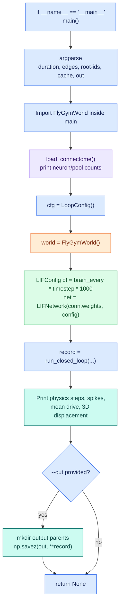

Actual CLI options သည် `--duration`, `--edges`, `--root-ids`, `--cache`, `--out` ဖြစ်ပါတယ်။ Gain tuning၊ world-backend selection၊ video နှင့် seed options မရှိပါ။ CLI သည် [FlyGymWorld](./world.py) ကိုပဲ ဆောက်ပြီး [OdysseyWorld](./world.py) သို့ switch မလုပ်ပါ။

### 7.4 `run_closed_loop()` flow

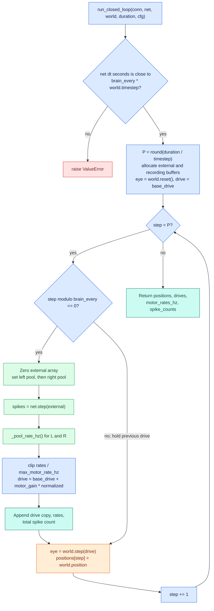

ဒီ loop တွင် သတိပြုရန်—

1. **ပထမ neural update သည် physics step 0 မစမီ ဖြစ်ပါတယ်။** Reset မှ ရသော eye signal ကို သုံးပါတယ်။
2. Neural update မရှိသော physics steps တွင် previous drive ကို hold လုပ်ပါတယ်။
3. `external[:] = 0` ဖြင့် neural step တိုင်း input buffer ကို ရှင်းပါတယ်။
4. Left pool ကို အရင် assign ပြီး right pool ကို နောက်မှ assign ပါတယ်။ Neuron တစ်ခု input pools နှစ်ခုလုံးထဲ ပါလျှင် right-eye value က overwrite ဖြစ်ပါတယ်၊ နှစ်ခု ပေါင်းထည့်ခြင်း မဟုတ်ပါ။
5. [run_closed_loop()](./closed_loop.py) သည် `world.reset()` ကိုခေါ်သော်လည်း `net.reset()` ကို **မခေါ်ပါ**။ Independent runs အတွက် network ကို reset သို့မဟုတ် အသစ်ဆောက်ရန် လိုပါတယ်။
6. Observation/position ကို physics step **ပြီးမှ** record ပါတယ်။ Reset position ကို `positions` ထဲ သီးခြားမသိမ်းပါ။
7. Default parameters ဖြင့် drive တစ်ဖက်စီသည် `0.8` မှ `1.4` အတွင်း ဖြစ်ပါတယ်။ Negative/braking drive ကို decoder က မထုတ်ပါ။

## 8. Runtime sequence and timing

### 8.1 Function call sequence

Sequence diagram ၏ background အရောင်များက initialization၊ neural computation နှင့် physics update ကို ခွဲပြထားပါတယ်။

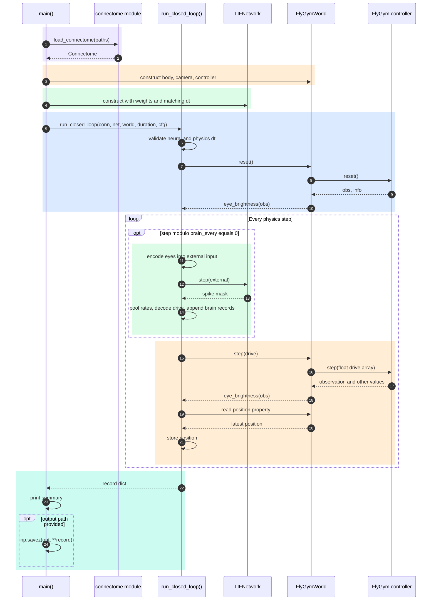

### 8.2 Two simulation clocks

```text
Physics step index:  0   1   2  ...  9 | 10  11 ... 19 | 20 ...
SNN update:         yes no  no ... no | yes no ... no | yes ...
Physics dt:         0.1 ms per step
SNN dt:             1.0 ms per update
```

Default configuration အတွက်—

```text
P = int(round(duration_s / 0.0001))
B = ceil(P / 10)              # P > 0 ဖြစ်လျှင်

duration_s = 1.0:
    P = 10,000 physics steps
    B = 1,000 neural updates
```

Duration သည် exact physics-step multiple မဟုတ်လျှင် Python `round()` ဖြင့် step count ကို ချိန်ပါတယ်။ Last partial 10-step block ရှိလျှင်လည်း block အစတွင် neural step အပြည့်တစ်ခု run ပါတယ်။ Requested duration နှင့် accumulated neural-update time သည် ထို edge case တွင် အတိအကျ တူချင်မှတူပါမယ်။

FlyGym 1.2.1 default vision refresh rate သည် 500 Hz ဖြစ်သောကြောင့် 1,000 neural updates တိုင်းမှာ အသစ် render လုပ်ထားသော retinal image ရမည်ဟု မဆိုလိုပါ။ Wrapper က latest available vision ကို သုံးပါတယ်။

## 9. Output and persistence

### 9.1 Cache နှင့် run record သည် မတူပါ

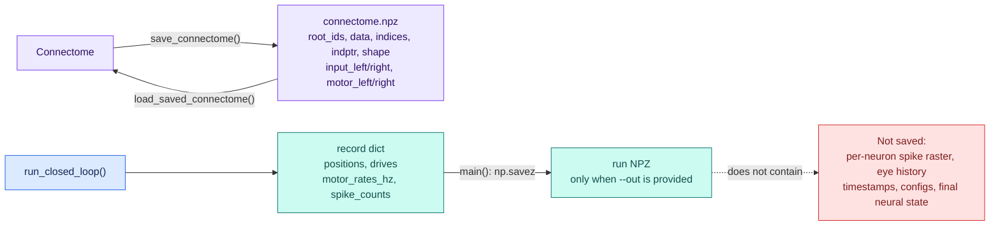

- Cache အတွင်း `data`, `indices`, `indptr`, `shape` သည် CSR matrix ကို ပြန်ဆောက်ရန် ဖြစ်ပါတယ်။
- Cache သည် LIF-scaled weights မဟုတ်ဘဲ signed raw aggregate weights ကို သိမ်းပါတယ်။
- Run NPZ သည် video မဟုတ်ပါ။ မတူသော run configurations ကို ပြန်သိနိုင်ရန် parameters ကို လက်ရှိအတိုင်းဆို သီးခြား မှတ်ထားရန် လိုပါတယ်။
- `np.savez()` ကို သုံးထားပြီး `np.savez_compressed()` မဟုတ်ပါ။
- Output path တူလျှင် file ကို overwrite လုပ်နိုင်ပါတယ်။

### 9.2 Printed metrics

[main()](./closed_loop.py) တွင်—

```text
total_spikes = sum(record["spike_counts"])
mean_drive = mean(record["drives"], axis=0)
displacement = norm(positions[-1] - positions[0])
```

ဟု တွက်ပါတယ်။

- Displacement သည် **ပထမ post-step position မှ နောက်ဆုံး post-step position သို့ 3D straight-line distance** ဖြစ်ပါတယ်။
- Reset location မှ ရွေ့သည့် distance အတိအကျ မဟုတ်သလို total walking path length လည်း မဟုတ်ပါ။
- Z-axis movement ပါဝင်နိုင်ပါတယ်။
- Pool rate သည် 1 ms window ၏ population-average rate ဖြစ်ပြီး smoothing မပါပါ။
- Motor rate ကို 100 Hz ထက်ကျော်လျှင် drive decoder က clip လုပ်သော်လည်း recorded `motor_rates_hz` ထဲက raw rates ကို clip မလုပ်ပါ။

## 10. Tests and coverage boundaries

လက်ရှိ [tests/](../tests/) တွင် test functions **14 ခု** ရှိပါတယ်။ အောက်ပါ diagram သည် test dependency/coverage map ဖြစ်ပြီး test execution order မဟုတ်ပါ။

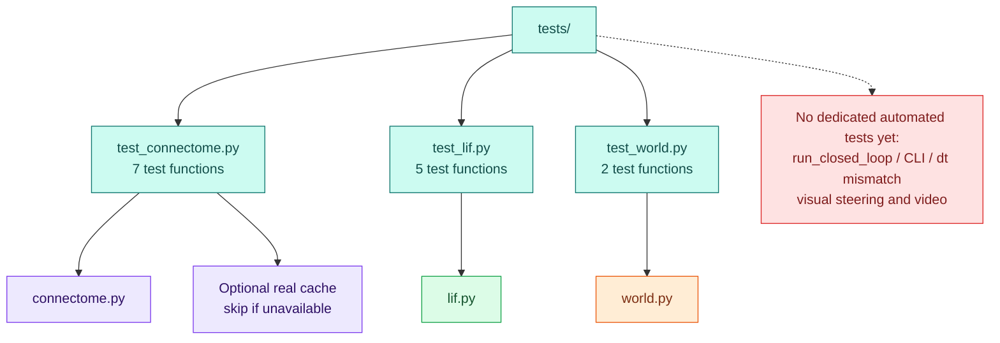

### 10.1 Connectivity tests

ရင်းမြစ်: [test_connectome.py](../tests/test_connectome.py)။

| Function | စစ်ဆေးသည့်အရာ |
| --- | --- |
| `_edge(...)` | Test helper၊ synthetic edge dictionary ဆောက်ပါတယ်။ Test ကိုယ်တိုင် မဟုတ်ပါ။ |
| `test_signed_weight_signs()` | ACh positive၊ GABA/glutamate negative weight formula |
| `test_duplicate_pairs_are_summed_and_unknown_ids_dropped()` | Duplicate pair sum နှင့် unknown post-ID edge ဖယ်ခြင်း |
| `test_weight_matrix_is_post_by_pre()` | `[post, pre]` matrix orientation |
| `test_input_pool_requires_optic_synapses_and_fraction()` | Input pool count/fraction thresholds |
| `test_motor_pool_uses_gng_output_and_side()` | GNG output thresholds နှင့် hemisphere split |
| `test_saved_connectome_round_trip(tmp_path)` | Root IDs နှင့် sparse weights save/load consistency |
| `test_real_connectome_cache_is_sane()` | Cache ရှိမှ neuron count၊ nonzero pairs နှင့် nonempty/disjoint motor pools စစ်ပါတယ်။ |

Round-trip test သည် root IDs/weights ကို assert လုပ်ထားသော်လည်း saved pools တစ်ခုချင်းစီကို equality assert မလုပ်ထားပါ။

### 10.2 Neural dynamics tests

ရင်းမြစ်: [test_lif.py](../tests/test_lif.py)။

| Function | စစ်ဆေးသည့်အရာ |
| --- | --- |
| `_net(dense, synapse_mv=25.0)` | Test helper၊ small dense example မှ sparse LIF network ဆောက်ပါတယ်။ |
| `test_no_input_no_spikes()` | Resting network တွင် spontaneous spikes မရှိခြင်း |
| `test_refractory_limits_firing_rate()` | Strong input ရှိလည်း refractory ကြောင့် spike frequency ကန့်သတ်ခြင်း |
| `test_excitatory_chain_propagates()` | Neuron 0 မှ neuron 1 သို့ next-step excitation |
| `test_inhibitory_synapse_suppresses_firing()` | Inhibitory connection ကြောင့် target firing တားခြင်း |
| `test_reset_restores_resting_state()` | Potential၊ counters နှင့် spike mask ပြန်လည် reset ဖြစ်ခြင်း |

### 10.3 World tests

ရင်းမြစ်: [test_world.py](../tests/test_world.py)။

| Function / fixture | စစ်ဆေးသည့်အရာ |
| --- | --- |
| `flygym_world()` | Module-scoped fixture၊ [FlyGymWorld](./world.py) ကို တည်ဆောက်ပြီး yield လုပ်ပါတယ်။ |
| `test_odyssey_world_is_not_implemented()` | Placeholder က `NotImplementedError` ပေးကြောင်း |
| `test_flygym_world_returns_eye_brightness_and_moves(flygym_world)` | Eye shape/range နှင့် 100 physics steps ပြီး position ပြောင်းကြောင်း |

Movement test သည် fly ရှေ့ကို meaningful walking လုပ်ကြောင်း၊ SNN က ထိန်းနေကြောင်း သို့မဟုတ် steering မှန်ကြောင်းကို မစစ်ပါ။ Position အနည်းငယ် ပြောင်းခြင်းသည် gravity/settling ကြောင့်လည်း ဖြစ်နိုင်ပါတယ်။

Suite run နည်းကို [01_README.md](./01_README.md) တွင် ဖော်ပြထားပါတယ်။ အစောပိုင်း run မှာ 14 tests passed ဖြစ်ခဲ့သော်လည်း ထိုရလဒ်သည် biological accuracy သို့မဟုတ် full closed-loop automated coverage ရှိသည်ဟု မဆိုလိုပါ။

## 11. Errors and extension points

### 11.1 Explicit branches နှင့် လက်ရှိ validation gaps

| အခြေအနေ | လက်ရှိ code behavior |
| --- | --- |
| SNN dt နှင့် `brain_every * world.timestep` မကိုက် | [run_closed_loop()](./closed_loop.py) မှ `ValueError` ပေးပါတယ်။ |
| Empty motor pool | [_pool_rate_hz()](./closed_loop.py) မှ `0.0` ပေးပါတယ်။ ထိုဘက် drive သည် base drive ဖြစ်နေပါမယ်။ Warning မပေးပါ။ |
| [OdysseyWorld](./world.py) ကို တည်ဆောက်ခြင်း | `NotImplementedError` ပေးပါတယ်။ Silent MuJoCo fallback မရှိပါ။ |
| File missing / corrupt cache / bad Feather | Underlying exceptions propagate လုပ်ပါတယ်။ Recovery/download မလုပ်ပါ။ |
| Zero/negative duration၊ zero `brain_every`၊ invalid rate/config | Comprehensive argument validation မရှိသေးပါ။ Runtime error သို့မဟုတ် empty records ဖြစ်နိုင်ပါတယ်။ |
| World reset မလုပ်မီ [position](./world.py) ကိုဖတ်ခြင်း | `_obs=None` အတွက် explicit guard မရှိပါ။ |
| Invalid array shapes / mismatched neuron counts | Comprehensive shape validation မရှိသေးပါ။ NumPy/SciPy indexing/matmul errors သို့မဟုတ် broadcasting ဖြစ်နိုင်ပါတယ်။ |
| Run တစ်ခုစီမှာ network state အဟောင်း သုံးမိခြင်း | [run_closed_loop()](./closed_loop.py) က neural reset မလုပ်သောကြောင့် caller က reset လုပ်ရန် လိုပါတယ်။ |
| Cached pools နှင့် source logic မကိုက်တော့ခြင်း | Cache schema/version/source fingerprint စစ်ခြင်း မရှိပါ။ |

### 11.2 Assumptions ကို code facts နှင့် မရောရန်

- ACh positive၊ GABA/glutamate negative ဟူသော sign formula သည် simplified assumption ဖြစ်ပါတယ်။
- Optic-neuropil နှင့် GNG thresholds များသည် heuristic mappings ဖြစ်ပါတယ်။
- Uniform LIF parameters နှင့် global median scaling သည် biophysically fitted model မဟုတ်ပါ။
- Base drive တစ်ခုတည်းဖြင့် walking ဖြစ်နိုင်သောကြောင့် movement ကို brain control သက်သေအဖြစ် တစ်ခုတည်း မသုံးရပါ။
- Flat arena + eye averaging ကြောင့် object/target-driven navigation မရှိသေးပါ။
- Existing software tests နှင့် saved run သည် software plumbing အလုပ်လုပ်ကြောင်း အထောက်အထား ဖြစ်ပြီး whole-brain behavior reproduction အတည်ပြုချက် မဟုတ်ပါ။

### 11.3 ဘယ်အရာ ပြောင်းလိုလျှင် ဘယ် code surface ကို ကိုင်ရမလဲ

အောက်ပါစာရင်းသည် နောက်ထပ်ပြင်ဆင်မည့်နေရာကို ညွှန်ပြခြင်းဖြစ်ပြီး feature များကို လက်ရှိ implement လုပ်ပြီးသားဟု မဆိုလိုပါ။

| ပြောင်းလိုသည့်အရာ | ဆက်စပ် code surfaces |
| --- | --- |
| Cell-type-verified input/output pools | [build_connectome()](./connectome.py)၊ cache rebuilding၊ [connectivity tests](../tests/test_connectome.py) |
| Spatial vision / optic flow encoding | [eye_brightness()](./world.py)၊ [run_closed_loop()](./closed_loop.py) ၏ input assignment၊ world/loop data contracts |
| Neural dynamics / synaptic scaling | [LIFConfig](./lif.py)၊ [LIFNetwork](./lif.py) နှင့် [LIF tests](../tests/test_lif.py) |
| Motor-rate smoothing / drive decoding | [_pool_rate_hz()](./closed_loop.py)၊ [LoopConfig](./closed_loop.py) နှင့် [run_closed_loop()](./closed_loop.py) |
| Arena / camera / body model | [FlyGymWorld.__init__()](./world.py) နှင့် [world tests](../tests/test_world.py) |
| Video / interactive viewer | [render()](./world.py)၊ [run_closed_loop()](./closed_loop.py) နှင့် [main()](./closed_loop.py) |
| Config metadata / extra records | [run_closed_loop()](./closed_loop.py) return dict၊ [main()](./closed_loop.py) serialization နှင့် output documentation |
| New world backend / Odyssey adapter | [world.py](./world.py) interface၊ [main()](./closed_loop.py) backend construction နှင့် timestep/observation compatibility |

**Source inventory အကျဉ်း:** Runtime Python modules ၅ ခုအတွင်း class ၆ ခု၊ source-defined function/method/property getter ၂၁ ခုရှိပါတယ်။ Dataclass-generated methods နှင့် external FlyGym/MuJoCo implementation များကို ထို callable count ထဲ မထည့်ထားပါ။ စာတမ်းသည် 2026-10-24 တွင် ဖတ်ရှုထားသော source structure ကို အခြေခံပါတယ်။