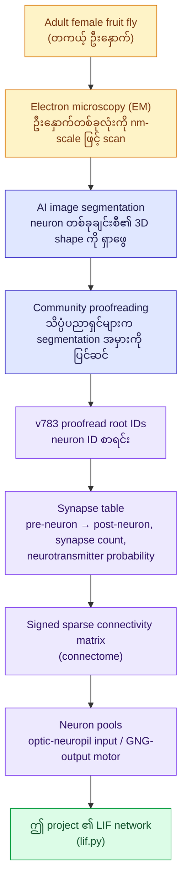
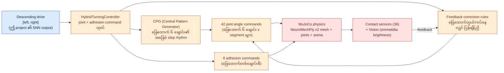

# 03 — မေးခွန်းနှင့် အဖြေများ (Q&A)

ဤစာတမ်းသည် project နှင့် ပတ်သက်သော အမေးများသော မေးခွန်းများကို စုစည်းထားသည်။
Install/run အတွက် [01_README.md](./01_README.md) ကိုလည်းကောင်း၊ code
အတွင်းပိုင်း အသေးစိတ်အတွက် [02_CODE.md](./02_CODE.md) ကိုလည်းကောင်း ကြည့်ပါ။

## မေးခွန်း ၁: Brain wiring ဆိုတာက fruit fly ၏ brain ကို အတုယူ တည်ဆောက်ထားတာလား? ဘယ်အဖွဲ့က develop လုပ်တာလဲ?

**Brain wiring ဆိုတာက artificial (အတု) မဟုတ်ပါ — တကယ့် biological ဒေတာဖြစ်သည်**

- ဤ project သည် **brain model အဆင်သင့် သို့မဟုတ် trained neural-network weights**
  ကို download လုပ်ထားခြင်း မဟုတ်ပါ။
- Download လုပ်ထားသည်မှာ **FlyWire** project က electron microscopy (EM) scan
  ဖြင့် တကယ့် adult female fruit fly (Drosophila) ၏ ဦးနှောက်တစ်ခုလုံးကို
  သေချာစွာ ပုံဖော်ထားသော **neuron IDs + synaptic connectivity data (wiring
  diagram)** ဖြစ်သည်။ ၎င်းကို "connectome" ဟု ခေါ်ပြီး တကယ့်ဦးနှောက်ရှိ neuron
  ချိတ်ဆက်မှု map တစ်ခု ဖြစ်သည် ([01_README.md](./01_README.md) ရှိ "Brain ကို
  ယူထားပုံ" အပိုင်း)။
- သို့သော် ဤ project ကိုယ်တိုင်ကတော့ ထို wiring data ပေါ်မှာ ရိုးရှင်းသော
  **LIF (leaky integrate-and-fire) neuron dynamics** ကို ကိုယ်တိုင်ရေးပြီး
  simulate လုပ်ထားခြင်းဖြစ်သည် ([lif.py](../fruitfly_brain/lif.py))။ Wiring
  diagram က "real" ဖြစ်သော်လည်း neuron fire-လုပ်ပုံ (dynamics) ကတော့
  simplified model တစ်ခုသာ ဖြစ်သည်။
- Fly ခန္ဓာကိုယ် (NeuroMechFly v2 body model) နှင့် FlyWire brain data သည်
  **သီးခြားရင်းမြစ်နှစ်ခု** ဖြစ်ပြီး တစ်ကောင်တည်းကနေ scan လုပ်ထားသော
  body–brain အတွဲ မဟုတ်ပါ။

**ဘယ်အဖွဲ့က develop လုပ်တာလဲ?**

FlyWire connectome project ကို **Princeton University** ရှိ **Mala Murthy**
နှင့် **Sebastian Seung** ၏ laboratory နှစ်ခုက ဦးဆောင်တီထွင်ခဲ့သည်:

- Electron microscopy ဒေတာ (brain scan) ကို **Janelia Research Campus** တွင်
  ရိုက်ကူးခဲ့သည်။
- AI-based image segmentation နှင့် ကမ္ဘာတစ်ဝှမ်းရှိ သိပ္ပံပညာရှင်များ
  ပါဝင်သော **community-proofreading** (crowd-sourced) ကို Princeton
  (Murthy & Seung labs) က စီစဉ်ဦးဆောင်ခဲ့သည်။
- NIH BRAIN Initiative, Wellcome Trust, NSF, Google, Amazon စသော
  အဖွဲ့အစည်းများက ရန်ပုံငွေ ထောက်ပံ့ခဲ့ကြသည်။

ဤ repo ([fruit_fly_brain](../README.md)) ကတော့ FlyWire ဒေတာကို **Zenodo
(record 10676866)** ကနေ download ယူပြီး သီးသန့် ရေးထားသော LIF simulation
code နှင့် ချိတ်ဆက်ထားခြင်းသာ ဖြစ်ပြီး FlyWire project ကိုယ်တိုင် develop
လုပ်ခြင်း မဟုတ်ပါ — FlyWire ဒေတာကို "သုံးစွဲသူ (consumer)" အနေဖြင့်
အသုံးပြုထားခြင်းသာ ဖြစ်သည်။

**ရင်းမြစ်:** [FlyWire](https://flywire.ai/) ·
[About FlyWire](https://codex.flywire.ai/about_flywire) ·
[FlyWire connectivity dataset DOI](https://doi.org/10.5281/zenodo.10676866) ·
[Princeton news article](https://www.princeton.edu/news/2024/10/02/mapping-entire-fly-brain-step-toward-understanding-diseases-human-brain)

## မေးခွန်း ၂: Connectome ဆိုတာ ဘာလဲ၊ ပုံနဲ့ ရှင်းပြပါ

**Connectome** ဆိုတာ ဦးနှောက်ထဲက **neuron (အာရုံကြော ဆဲလ်) တစ်ခုချင်းစီကို
ဘယ်သူနဲ့ ဘယ်လိုအားနဲ့ (synapse အရေအတွက်) ချိတ်ဆက်ထားသလဲ** ဆိုတာကို
အကုန်မြေပုံဆွဲထားတဲ့ "wiring diagram" တစ်ခု ဖြစ်သည်။ လျှပ်စစ်ပတ်လမ်းကြောင်း
(circuit diagram) တစ်ခုလိုပဲလို့ စဉ်းစားနိုင်သည် — ဒါပေမယ့် ဒီမှာ "ဝါယာ"
တွေက biological neuron တွေကြားက synaptic connection များ ဖြစ်သည်။

**Diagram ရှင်းလင်းချက်:**

1. **Fly brain scan** — တကယ့် adult female fruit fly ၏ ဦးနှောက်တစ်ခုလုံးကို
   electron microscope ဖြင့် nanometer-scale ပုံရိပ်များ ရိုက်ကူးသည်။
2. **Segmentation** — AI algorithm များက ပုံရိပ်များထဲမှ neuron တစ်ခုချင်းစီ
   ၏ 3D ပုံသဏ္ဍာန်ကို ခွဲခြားသိရှိသည်။
3. **Proofreading** — segmentation အမှားများ (neuron နှစ်ခု ပေါင်းသွားခြင်း/
   ပြတ်သွားခြင်း) ကို ကမ္ဘာတစ်ဝှမ်းရှိ သိပ္ပံပညာရှင်များက လက်ဖြင့် ပြင်ဆင်သည်
   (crowd-sourced community effort)။
4. **Root IDs + synapse table** — ပြင်ဆင်ပြီးသား neuron တစ်ခုချင်းစီကို ID
   နံပါတ် ပေးထားပြီး၊ ဘယ် neuron က ဘယ် neuron ကို ဘယ်နှစ်ချက် synapse ဖြင့်
   ဆက်သွယ်ထားသည်၊ excitatory/inhibitory (neurotransmitter) အမျိုးအစား
   ဖြစ်နိုင်ခြေကို မှတ်တမ်းတင်ထားသည်။
5. **Connectivity matrix** — ထို synapse table ကို signed sparse matrix
   (ဂဏန်းဇယား) အဖြစ် ပြောင်းလဲသည်; ဤ project ၏
   [connectome.py](../fruitfly_brain/connectome.py) က ဒီအဆင့်ကို လုပ်ဆောင်သည်။
6. **Neuron pools** — မျက်စိနှင့် ဆက်စပ်သော optic-neuropil neuron များကို
   "input pool"၊ GNG (gnathal ganglion) ဘက်ရှိ descending/motor-related
   neuron များကို "output pool" အဖြစ် heuristic ဖြင့် ရွေးချယ်သည်။
7. **LIF network** — ဤ connectivity matrix ကို [lif.py](../fruitfly_brain/lif.py)
   ရှိ leaky integrate-and-fire dynamics က run ပြီး input pool ထဲ vision
   brightness ကို ထည့်ကာ output pool မှ spike activity ကို ထုတ်ပေးသည်။

အကျဉ်းချုပ်ပြောရလျှင် — connectome သည် **ဦးနှောက်ရဲ့ hardware wiring diagram**
ဖြစ်ပြီး၊ ထို wiring ပေါ်တွင် run သော neuron dynamics (firing behavior) က
software/simulation ဖြစ်သည်။

## မေးခွန်း ၃: NeuroMechFly v2 body model က ဘာအလုပ်လုပ်သလဲ? ဘယ်လို အလုပ်လုပ်သလဲ?

**ဘာအလုပ်လုပ်သလဲ (ရည်ရွယ်ချက်)**

**NeuroMechFly v2** သည် adult female fruit fly ၏ **micro-CT scan** ကို
အခြေခံထားသော biomechanical (ကိုယ်ခန္ဓာနှင့် ဆက်စပ်) model တစ်ခုဖြစ်ပြီး၊
ခြေထောက် ၆ ချောင်း၊ အတောင်၊ ဦးခေါင်း၊ မျက်စိနှစ်ဖက်အပါအဝင် fly ကောင်ခန္ဓာတစ်ခုလုံး၏
ပုံသဏ္ဍာန်၊ joint၊ mass ကို အသေးစိတ် ပြန်လည်ထုတ်ဖော်ထားသည်။ ၎င်းကို
MuJoCo physics engine ထဲတွင် run ရန်အတွက် MJCF XML + mesh အဖြစ် ထုတ်ပေးထားပြီး
**FlyGym** library (EPFL NeLy Lab) မှတစ်ဆင့် Python ကနေ ထိန်းချုပ်ပါတယ်
([01_README.md](./01_README.md), "Simulator နှင့် body ကို ယူထားပုံ" အပိုင်း)။

ရည်ရွယ်ချက်ကတော့ — အစစ်ဖြစ်သော fly ၏ လမ်းလျှောက်ခြင်း (walking)၊ လှည့်ခြင်း
(turning)၊ မျက်စိဖြင့်မြင်ခြင်း (vision) နှင့် မျက်နှာပြင်ကို ကပ်ညပ်ခြင်း
(adhesion) စတဲ့ အမူအကျင့်များကို physically-accurate simulation ထဲမှာ
ပြန်လည်ဖော်ပြနိုင်ရန် ဖြစ်သည်။

**ဘယ်လို အလုပ်လုပ်သလဲ (architecture)**

**အဆင့်ဆင့် ရှင်းပြချက်:**

1. **Input** — ဤ project ၏ SNN (သို့မဟုတ် မည်သည့် controller မဆို) က
   `[left, right]` ဟူသော ၂-တန်ဖိုး descending drive ကို ပေးပို့သည်
   ([world.py](../fruitfly_brain/world.py) ၏
   `FlyGymWorld.step(drive)`)။
2. **CPG (Central Pattern Generator)** — ခြေထောက် ၆ ချောင်း (`LF, LM, LH,
   RF, RM, RH`) တစ်ခုချင်းစီ၏ အခြေခံ step rhythm (ဘယ်အချိန် မြေပြင်ကို
   တွယ်ရမည်၊ ဘယ်အချိန် ချီရမည်) ကို feedforward အနေဖြင့် ထုတ်ပေးသည်။
3. **Hybrid turning controller** — `drive` ၏ left/right value များကို CPG
   amplitude အဖြစ် asymmetric ပြောင်းလဲကာ ဘယ်/ညာ လှည့်ခြင်းကို ဖြစ်ပေါ်စေသည်
   (left/right drive မတူညီလျှင် fly က ထိုဘက်ကို လှည့်သည်)။
4. **Feedback correction** — ခြေထောက်တစ်ချောင်း တွယ်မိနေလျှင် (stuck)
   သို့မဟုတ် မြေပြင်ကို မမှီသေးလျှင် low-level reflex rule များက ပြန်ချိန်ညှိ
   ပေးသည် — ဒါက biological fly ၏ reflex ကို အတုယူထားခြင်း ဖြစ်သည်။
5. **Output** — ခြေထောက် joint ၄၂ ခု အတွက် angle command များနှင့် ခြေထောက်
   ၆ ချောင်းစီအတွက် adhesion (ကပ်ညပ်မှု) on/off command ၆ ခု ထုတ်ပေးသည်
   ([world.py](../fruitfly_brain/world.py) ၏ `Fly(enable_adhesion=True, ...)`)။
6. **Physics simulation** — ဤ joint/adhesion command များကို MuJoCo physics
   engine က gravity၊ collision၊ ground contact နှင့်အတူ simulate လုပ်သည်။
   Contact sensor (ခြေထောက် segment တစ်ခုချင်းစီ x 6 segment = 36 placements)
   နှင့် vision (ommatidia brightness) က sensory feedback ကို ပြန်ပေးသည်။
7. **Loop ပြန်လည်ဖြစ်ခြင်း** — ရရှိလာသော vision brightness ကို ဤ project ၏
   SNN ထဲ ပြန်ထည့်ပြီး closed-loop simulation ဆက်လက် run သည်
   ([closed_loop.py](../fruitfly_brain/closed_loop.py))။

**သတိပြုရန်:** ဤ project ၏ SNN သည် ခြေထောက် joint တစ်ခုချင်းကို တိုက်ရိုက်
မထိန်းချုပ်ပါ — SNN output ကို `[left, right]` drive အဖြစ်သာ ပြောင်းပြီး
FlyGym ၏ `HybridTurningController` (NeuroMechFly v2 ၏ walking logic) က
joint/adhesion အသေးစိတ်ကို ဆက်တွက်သည် ([02_CODE.md](./02_CODE.md), "Architecture" အပိုင်းရှိ "အရေးကြီးသော ခွဲခြားချက်")။ Body model ကိုယ်တိုင်ကို ကျွန်ုပ်တို့
ကိုယ်တိုင် ရေးထားခြင်း မဟုတ်ဘဲ FlyGym package ထဲက ready-made component
တစ်ခု ဖြစ်သည်။

**ရင်းမြစ်:** [FlyGym v1.2.1 source](https://github.com/NeLy-EPFL/flygym/tree/v1.2.1) ·
[NeuroMechFly documentation](https://neuromechfly.org/) ·
[NeuroMechFly v2, Nature Methods](https://www.nature.com/articles/s41592-024-02497-y) ·
[Hybrid controller tutorial](https://nely-epfl.github.io/flygym-gymnasium/tutorials/hybrid_controller.html)
